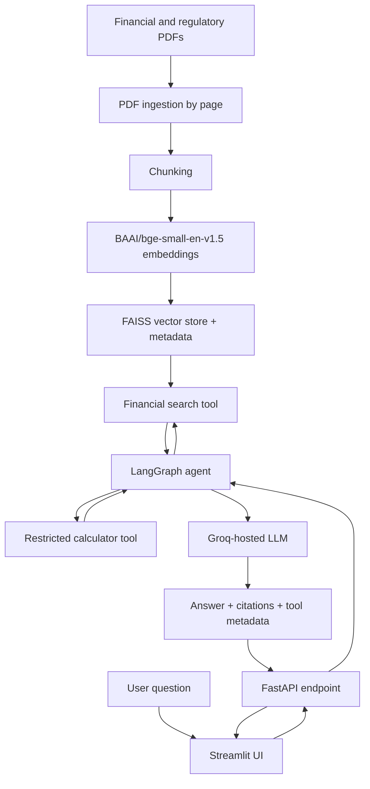
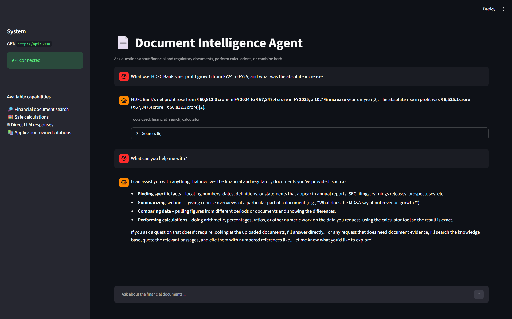

# FinTech Document Intelligence Agent

A document-grounded question-answering agent for financial and regulatory reports. The project combines retrieval-augmented generation (RAG), a FAISS vector store, LangGraph tool orchestration, a FastAPI backend, and a Streamlit chat interface.

The agent can search the indexed documents, perform supported arithmetic with a restricted calculator tool, combine retrieval with calculations, and return answers with document/page citations. It is a portfolio project and evaluation prototype, not a financial-advice system.

## Features

- **Financial document search:** semantic search across the indexed reports using normalized embeddings and FAISS inner-product similarity.
- **RAG answers:** responses are grounded in retrieved excerpts and can include numbered source citations.
- **Tool-using agent:** LangGraph coordinates a financial-search tool and a safe, restricted calculator.
- **Source metadata:** answers return source filename, PDF page, document type, relevance score, and chunk identifier where available.
- **REST API:** FastAPI exposes health and question-answering endpoints, with interactive API documentation.
- **Web UI:** Streamlit provides a chat interface, API status, tool-use information, and expandable source details.
- **Automated tests and evaluation:** unit/integration tests plus separate retrieval and answer evaluation scripts.
- **Docker Compose:** runs the API and frontend as separate services from a shared image.

## Architecture



Streamlit communicates with FastAPI over HTTP. It does not invoke the agent directly. The API loads the existing FAISS index and metadata; the Docker startup path does not re-ingest the PDFs or rebuild embeddings.

## Technology stack

- **Language:** Python 3.12
- **LLM / orchestration:** Groq, LangChain, LangGraph
- **Embeddings:** Sentence Transformers / Hugging Face, `BAAI/bge-small-en-v1.5`
- **Vector search:** FAISS (`IndexFlatIP`) with L2-normalized vectors
- **API:** FastAPI, Uvicorn, Pydantic
- **Frontend:** Streamlit
- **Data processing:** PyMuPDF, NumPy
- **Testing:** pytest
- **Containerization:** Docker, Docker Compose

## Documents and indexed data

The document collection used during development contains:

- `HDFC_Bank_Annual_Report_2024_25.pdf`
- `ICICI_Bank_Annual_Report_2024_25.pdf`
- `Paytm_Annual_Report_2024_25.pdf`
- `RBI_Payments_Vision_2025.pdf`
- `SEBI_Annual_Report_2024_25.pdf`

The ingestion run extracted 1,548 page-level documents and approximately 4.51 million characters. Recursive chunking produced 4,990 chunks (chunk size 1,200 characters, overlap 200 characters). The embedding matrix uses 384-dimensional vectors.

The runtime FAISS artifacts are:

```text
data/processed/faiss_store/
├── index.faiss
└── metadata.json
```

**Both files are required** by the API and the Docker build. Keep them in the repository or provide them locally before building. The original PDFs are needed if you want to rerun ingestion and regenerate the vector store.

## Prerequisites

### For Docker (recommended)

- Docker Desktop with Docker Compose
- A Groq API key and access to the model configured in `.env`
- Internet access on first startup to download the embedding model, unless it is already present in the Hugging Face cache

### For local Python execution

- Python 3.12
- A Groq API key
- Internet access for the first download of the embedding model and for LLM requests

## Configuration

1. Copy the example file to create your local environment file:

   **PowerShell:**

   ```powershell
   Copy-Item .env.example .env
   ```

2. Edit `.env` and set your own `GROQ_API_KEY`. Do not commit `.env` or paste its contents into issues, logs, or public chats.

Example variables (the API key below is only a placeholder):

```dotenv
GROQ_API_KEY=your_groq_api_key_here
GROQ_MODEL=openai/gpt-oss-120b
API_BASE_URL=http://127.0.0.1:8000
```

For Docker Compose, the frontend's `API_BASE_URL` is overridden to `http://api:8000`, which is the API service name on the Compose network.

## Run with Docker Compose

Run the following commands from the repository root. Ensure the FAISS files listed above are present first.

```powershell
# Validate the Compose configuration

docker compose config --quiet

# Build the image and start the API and Streamlit services

docker compose up --build -d

# Inspect status and logs

docker compose ps
docker compose logs --tail 100 api
docker compose logs --tail 100 frontend
```

Open these URLs in a browser:

- **Streamlit UI:** http://localhost:8501
- **API health:** http://localhost:8000/health
- **FastAPI Swagger documentation:** http://localhost:8000/docs

Expected health response:

```json
{"status":"ok"}
```

Stop the services when finished:

```powershell
docker compose down
```

The Compose setup uses a named volume for the Hugging Face model cache. The first image build is large because it installs ML dependencies; the first query may also need to initialize/download the embedding model. The current image includes CPU-based ML dependencies and can require several gigabytes of disk space.

## Run locally without Docker

Create and activate a virtual environment from the project root, then install the dependencies:

```powershell
py -3.12 -m venv .venv
.\.venv\Scripts\Activate.ps1
python -m pip install --upgrade pip
python -m pip install -r requirements.txt
Copy-Item .env.example .env
```

Set `GROQ_API_KEY` in `.env`, then open **two PowerShell terminals** with the virtual environment activated.

Terminal 1 — start FastAPI:

```powershell
uvicorn src.api.main:app --host 127.0.0.1 --port 8000
```

Terminal 2 — start Streamlit:

```powershell
$env:API_BASE_URL = "http://127.0.0.1:8000"
streamlit run app/streamlit_app.py --server.port 8501
```

Then open http://localhost:8501. If PowerShell blocks activation, follow your local Python/Windows environment policy rather than disabling security settings system-wide.

## API endpoints

| Method | Endpoint | Purpose |
|---|---|---|
| `GET` | `/health` | Health check; returns `{"status":"ok"}` |
| `POST` | `/api/v1/ask` | Submit a question to the agent |
| `GET` | `/docs` | Interactive Swagger UI for trying the API |

Example request body for `POST /api/v1/ask`:

```json
{
  "question": "What was HDFC Bank's net profit in FY25?"
}
```

The response includes the question, answer, sources, and tools used. Use `/docs` for the exact request/response schema exposed by the running version.

## Example questions

- What was HDFC Bank's net profit in FY25?
- What was HDFC Bank's net interest margin in FY25?
- What was HDFC Bank's capital adequacy ratio in FY25?
- What was the absolute difference between two supplied numbers?
- What was HDFC Bank's net profit growth from FY24 to FY25?
- What can you establish from the uploaded documents, and what is not supported by them?

For facts that are not established by the indexed documents, the intended behavior is to state that the available evidence is insufficient rather than invent a figure or citation.

## Tests

Run the automated tests from the project root:

```powershell
python -m pytest -v
```

The latest recorded test run completed with **37 passed**. The tests cover ingestion/chunking, embeddings and vector-store behavior, RAG mechanics, agent/tool behavior, citation handling, and API/client behavior. LLM calls in automated tests are mocked; the suite does not replace a live end-to-end check against Groq.

## Evaluation results

The included evaluation report and JSON result files record the following results from the curated test set:

| Evaluation | Result |
|---|---:|
| Retrieval questions | 5 |
| Retrieval Hit@5 | 100% (5/5) |
| Mean Reciprocal Rank (MRR) | 0.80 |
| Answer questions | 10 |
| Automated answer checks passed | 10/10 (100%) |
| Answer cases requiring manual review | 10/10 |

Reports:

- `data/processed/evaluation_report.md`
- `data/processed/retrieval_evaluation_results.json`
- `data/processed/answer_evaluation_results.json`

**Interpretation:** These are initial results from a small, manually curated evaluation set. The answer-evaluation program marks all ten cases for manual review; a 100% automated pass rate is not proof of complete factual correctness. Expand the question set and manually verify generated answers and cited passages before making stronger quality claims.

## Repository layout

```text
.
├── app/
│   └── streamlit_app.py
├── data/
│   ├── raw/                         # Source financial/regulatory PDFs
│   └── processed/
│       └── faiss_store/
│           ├── index.faiss
│           └── metadata.json
├── src/
│   ├── agents/                      # LangGraph agent and tools
│   ├── api/                         # FastAPI app, schemas, HTTP client
│   ├── evaluation/                  # Retrieval and answer evaluation
│   ├── generation/                  # LLM, prompts, RAG chain
│   ├── ingestion/                   # PDF extraction and chunking
│   └── retrieval/                   # Embeddings and FAISS search
├── tests/                           # Automated tests and evaluation questions
├── .env.example                     # Safe configuration template
├── .dockerignore
├── .gitignore
├── compose.yaml
├── Dockerfile
├── requirements.txt
└── README.md
```

## Known limitations

- The retrieval evaluation contains only five questions, and the answer evaluation contains ten; metrics are not representative of all possible user queries.
- Automated checks are lightweight screening signals and all answer cases are flagged for manual review.
- The embedding model runs locally on CPU in the current Docker configuration; initial model loading/download can take time.
- Responses depend on the indexed documents and the availability/limits of the configured Groq model.
- This is a technical demonstration, not a substitute for checking primary financial reports or obtaining professional financial advice.

## Security notes

- Never commit `.env`, API keys, or other credentials.
- Keep `.env.example` as a placeholder-only template.
- Review `git status` before committing to ensure secrets, temporary backups, virtual environments, Python caches, and unintended generated files are not included.
- Keep `data/processed/faiss_store/index.faiss` and `metadata.json` available because the current Dockerfile expects them at build time.


## Screenshots

### Streamlit application

The application answers questions using the indexed financial
documents and displays source citations and tool usage.



## Future Improvements

- Support document uploads and controlled index updates.
- Improve retrieval with hybrid search, reranking, and metadata filters.
- Expand the evaluation dataset and manually verify answer correctness
  and citation accuracy.
- Add structured logging, performance monitoring, and clearer error handling.
- Optimize Docker image size and embedding-model startup time.


## License and document rights

No project license is declared in this README.